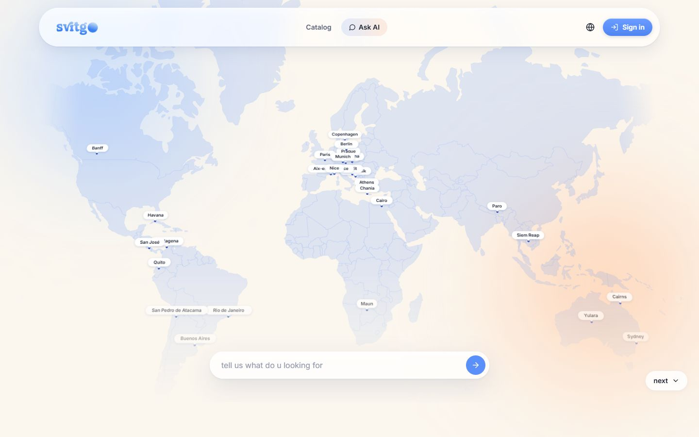
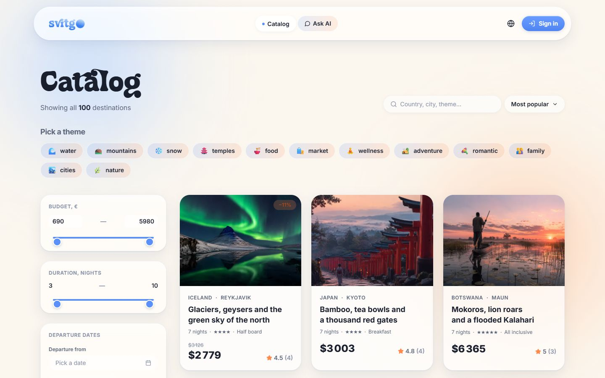
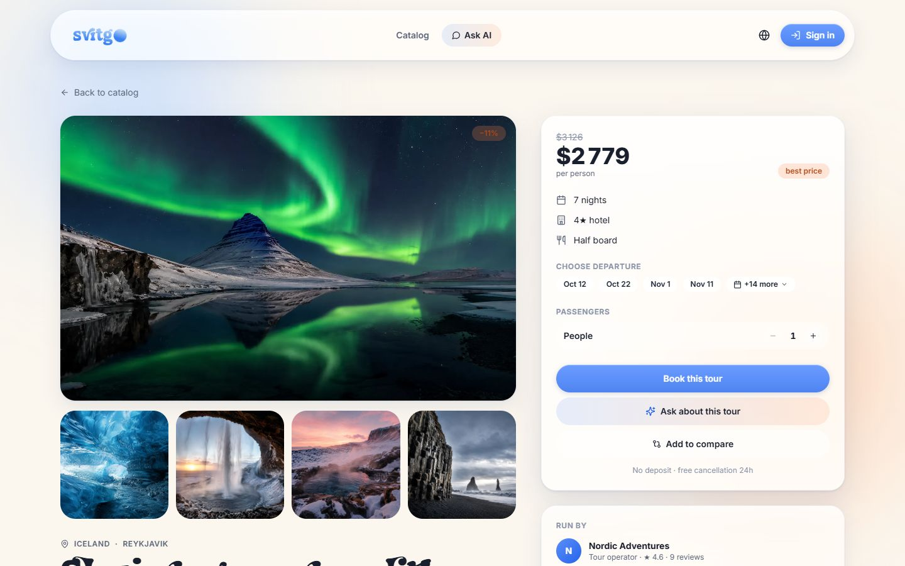
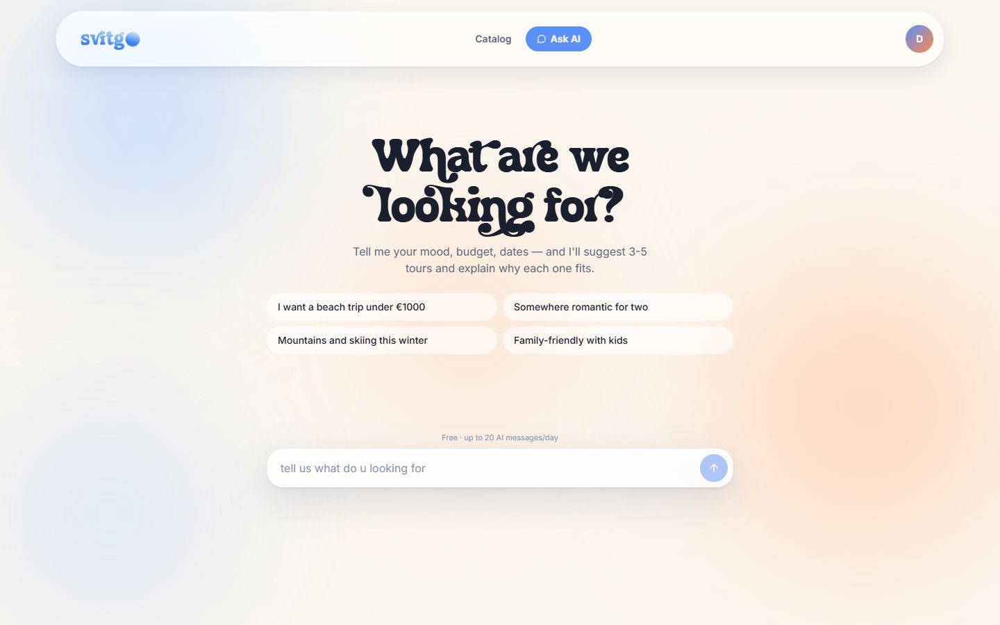
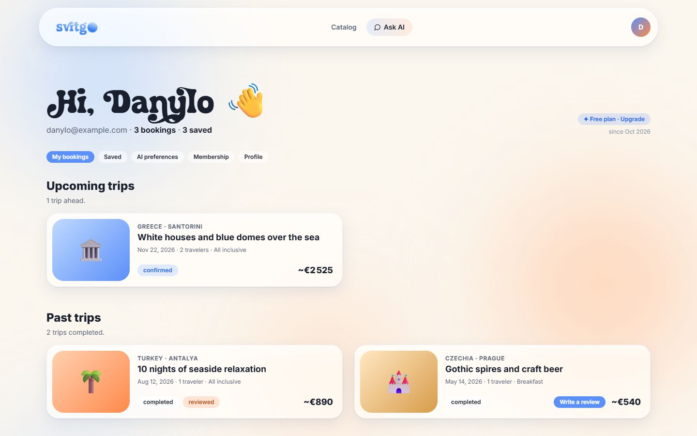
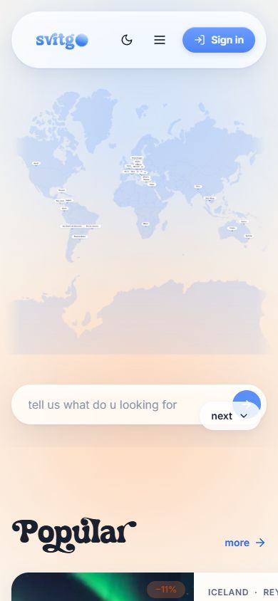

# SvitGo

A full-stack tour booking platform with an AI travel assistant. Travellers browse and compare tours, chat with an assistant that recommends trips, book departures and leave reviews. Tour organisers manage their own tours and bookings, and admins moderate everything.

**Live demo: [svit-go.vercel.app](https://svit-go.vercel.app/)**. Demo account: `danylo@example.com` / `password`. The API runs on a free plan and is kept awake from 09:00 to 24:00 Kyiv time; at night the first request may take up to a minute, and all demo data is rebuilt when the server wakes up. The AI assistant is limited to a small number of requests per day for the whole site.

## Trailer

<p align="center">
  <a href="docs/trailer/svitgo-trailer.mp4">
    
  </a>
</p>

A 35-second product trailer: [watch the full video](docs/trailer/svitgo-trailer.mp4) (MP4, 1080p, with sound).

## Screenshots

<p align="center">
  
  
</p>
<p align="center">
  
  
</p>
<p align="center">
  
  
</p>

## Features

- **Catalogue** of tours with filters, interactive world map, popularity and ratings
- **AI assistant** (chat, tour explanation, side-by-side tour comparison) powered by the OpenAI API, called only from the server
- **Bookings** with departures, currencies and saved tours
- **Reviews** with photos
- **Subscriptions** with per-tier daily limits for AI requests
- **Organiser cabinet**: create and edit tours, see bookings
- **Admin panel**: dashboard, organiser and admin management, tour moderation, bookings

## Tech stack

| Part | Stack |
|---|---|
| `web` | React, TypeScript, Vite, Tailwind CSS, React Router, SWR, Framer Motion, react-simple-maps |
| `server` | Node.js, Express, TypeScript, Prisma (SQLite), Zod, JWT, bcrypt, Helmet, express-rate-limit |
| Tests | Vitest (server) |
| Deploy | Vercel (web), Render (API) |

## Getting started

Requirements: Node.js 20+.

```bash
# API
cd server
cp .env.example .env        # fill in JWT_SECRET and, optionally, OPENAI_API_KEY
npm install
npm run db:push
npm run db:seed:json -- ./data/tours.json   # or: npm run db:seed
npm run dev                 # http://localhost:3001

# Web (in another terminal)
cd web
npm install
npm run dev                 # http://localhost:5173
```

Create the first admin (credentials are read from the environment, nothing is stored in the repo):

```bash
cd server
ADMIN_EMAIL=you@example.com ADMIN_PASSWORD='a-long-password' npm run db:seed:admin
```

Run the tests: `cd server && npm test`.

## Configuration

All configuration is done through environment variables; see [`server/.env.example`](server/.env.example).

| Variable | Description |
|---|---|
| `DATABASE_URL` | Prisma database URL (SQLite by default) |
| `JWT_SECRET` | secret for signing tokens; in production the server refuses to start with a missing or weak value |
| `CORS_ORIGIN` | allowed web origin |
| `OPENAI_API_KEY` | key for the AI assistant, kept on the server only and never sent to the browser |
| `OPENAI_MODEL` | model name |
| `AI_GLOBAL_DAILY_CAP` | optional hard ceiling of OpenAI calls per UTC day for the whole server (0 = off); recommended for public demos |

## Free demo deployment

The repository includes a [`render.yaml`](render.yaml) for the API on Render's free plan and a Vite app in `web` for Vercel or any static host.

1. **API (Render):** create a Blueprint from this repository. On every start the free instance builds a fresh SQLite database and loads the demo data (100 tours with photos, reviews, demo accounts), so visitor data does not persist. Set `CORS_ORIGIN` to the web URL and, optionally, `OPENAI_API_KEY`.
2. **Web (Vercel):** import the repository with `web` as the root directory and set `VITE_API_URL` to the API URL (no trailing slash).

The free API instance sleeps after 15 minutes without traffic, so the first request afterwards takes up to a minute. The workflow [`keep-awake.yml`](.github/workflows/keep-awake.yml) pings the API every 5 minutes between 09:00 and 24:00 Kyiv time (about 15 hours a day, well below Render's 750 free instance hours per month). Use a separate OpenAI key with a small spending limit for a public demo: subscriptions are simulated, so every visitor can select the unlimited tier and `AI_GLOBAL_DAILY_CAP` is the safety net.

## Security notes

- Secrets live only in environment variables; `.env` files and local databases are git-ignored.
- AI requests go through the API, which applies authentication, a global per-IP rate limit and a per-tier daily cap.

## Project structure

```
web/
  src/pages/        routes: catalogue, tour, booking, chat, compare, account, organiser, admin
  src/components/   UI components
server/
  src/routes/       REST API: tours, bookings, reviews, auth, organisers, admin, ai-*
  src/lib/          LLM client, matching, ratings, currency, subscriptions
  prisma/           schema and seed scripts
  data/             sample tour and review data
```
